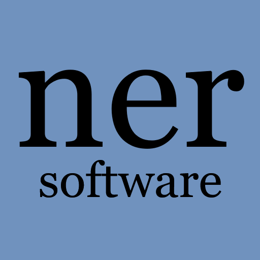

---
# the default layout is 'page'
icon: fas fa-info-circle
order: 7
---

## Where L2 came from

In the early 2000s there was an FPS that didn't fit the mould. No rifles or rocket
launchers. You picked a Paladin, a Druid or a Sorceress and fought with a longsword, a
crossbow or a staff that spat green fire. Teams escorted kings through castle halls.
It had a small, devoted community, and then the servers went dark and the game was
abandoned.

Nothing since has quite scratched that itch. L2 is an attempt to bring it back.

## What L2 is

- **A rebuild, not a sequel.** The goal is the original's feel: its classes, weapons,
  pacing and odd charm, played on today's hardware.
- **Built on a modern engine.** Unity 6, with Photon Fusion networking for
  responsive, server-authoritative multiplayer.
- **Faithful where it counts.** Weapon timings, damage, projectile speeds, movement and
  even the original field of view are matched to the old game's data and measurements,
  not guessed.
- **Improved where it should be.** Better netcode, better rendering, modern controls
  and rebindable keys.

## Who's making it

{: w="160" h="160" .left }

L2 is made by **ner software**. It's currently a **solo-dev project**: one developer,
building it in the evenings, who played the original far too much.

Progress is posted in the dev diary on the [home page]({{ '/' | relative_url }}), and
known problems are listed on the [issues]({{ '/issues/' | relative_url }}) page.

## Disclaimer

This is an unofficial fan-made remake of Legends of Might and Magic, originally developed by
New World Computing and published by 3DO. It is not affiliated with or endorsed by 3DO, New
World Computing, or the current rights holders of the Might and Magic series.

L2 was created as a tribute to the original game and its legacy. It has been a work in
progress for almost 25 years. L2 is the sole work of nerseus with help from:

- [Unity](https://unity.com)
- [Photon Fusion](https://doc.photonengine.com/fusion/v2/game-samples/br200/overview) and its BR200 sample
