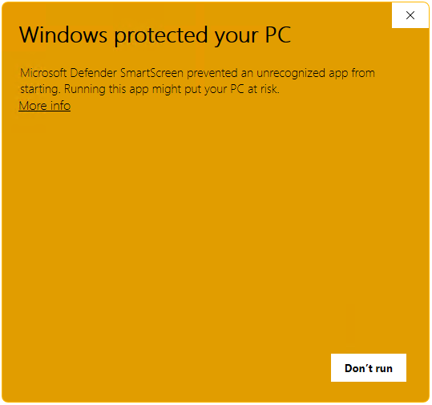
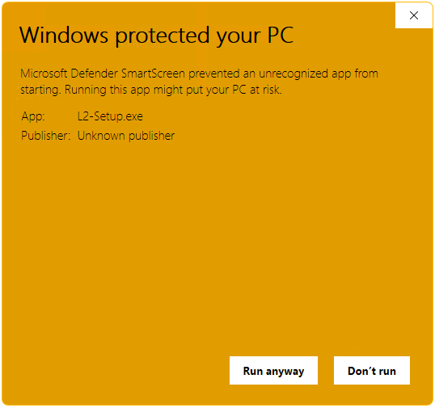

L2 runs on Windows. To install it, download the installer and run it.

<a class="btn btn-primary btn-lg" href="https://downloads.nersoftwarellc.com/L2Assets/installer/L2-Setup.exe"><i class="fas fa-download"></i> Download L2-Setup.exe</a>

1. **Download** the installer with the button above.
2. **Run** `L2-Setup.exe`. It installs L2 for your Windows user only, so it doesn't ask for
   an administrator password.
3. **Start L2.** On the first run, the setup screen asks for the game assets: press
   **Download** to fetch them. They're large, so this can take a while, but it only
   happens once. After that, L2 only downloads them again when an update needs it.

## Windows SmartScreen

When you run the installer, Windows may show a box saying **"Windows
protected your PC"**.

This appears because the installer isn't signed with a code-signing certificate that
identifies ner software, so Windows lists the publisher as "Unknown publisher". It
doesn't mean anything was found in the file.

To let it run:

1. Click **More info**.

   {: w="539" h="505" }

2. Check that the app is **L2-Setup.exe**, then click **Run anyway**.

   {: w="538" h="505" }

You only need to do this once per installer.
